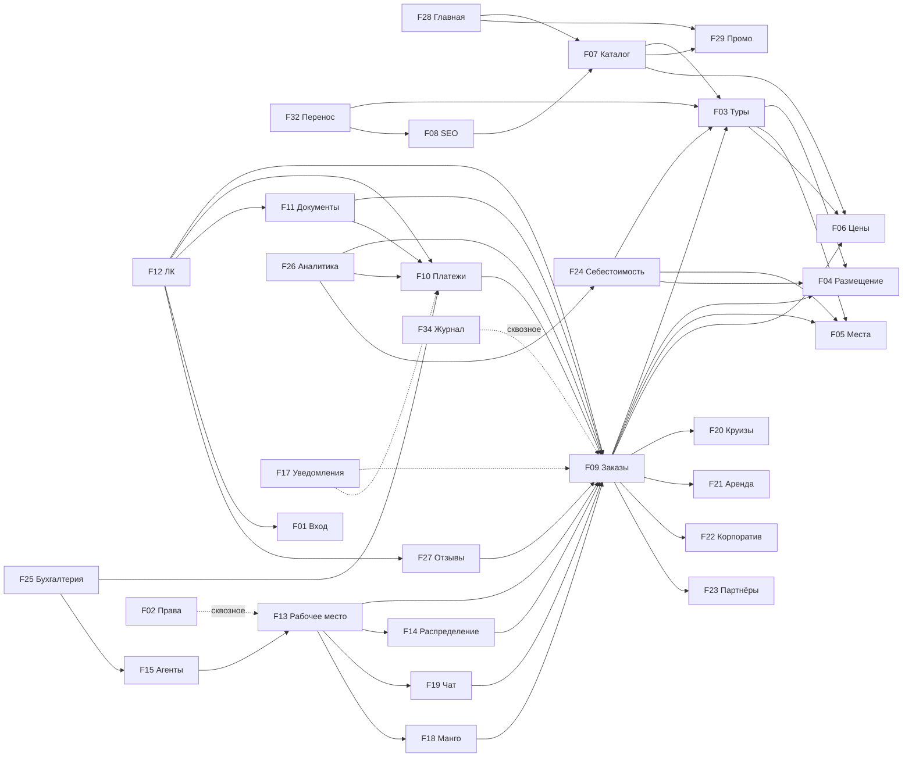

# Карта функционалов и связей

## Реестр
| ID | Функционал | Важность | Воркфлоу | Этап | Статус |
|---|---|---|---|---|---|
| F01 | [Авторизация](features/F01-auth/context.md) (sms.ru, почта, сотрудники, агенты) | P0 | WF-1,2,5 | 1 | спроектировано |
| F02 | [Роли и права](features/F02-rbac/context.md) | P0 | все | 1 | спроектировано |
| F03 | [Туры и выезды](features/F03-tours/context.md) | P0 | WF-1,3 | 1 | спроектировано |
| F04 | [Размещение](features/F04-accommodation/context.md) (отели, квоты, подселение) | P0 | WF-1,3 | 1 | спроектировано |
| F05 | [Транспорт и места](features/F05-transport-seats/context.md) | P0 | WF-1,2,3 | 1 | спроектировано |
| F06 | [Ценообразование](features/F06-pricing/context.md) | P0 | WF-1,2,3 | 1 | спроектировано |
| F07 | [Каталог и поиск](features/F07-catalog/context.md) | P0 | WF-1,7 | 1 | спроектировано |
| F08 | [SEO и URL](features/F08-seo/context.md) | P0 | WF-1,7 | 1 | спроектировано |
| F09 | [Заказы](features/F09-orders/context.md) | P0 | все | 1 | спроектировано |
| F10 | [Платежи и долги](features/F10-payments/context.md) | P0 | WF-1,2,4 | 1 | спроектировано |
| F11 | [Документы](features/F11-documents/context.md) | P1 | WF-1,2,6,8 | 1 | спроектировано |
| F12 | [ЛК туриста](features/F12-client-cabinet/context.md) | P0 | WF-1,8 | 1 | спроектировано |
| F13 | [Рабочее место продаж](features/F13-sales-workspace/context.md) | P0 | WF-2,5 | 1 | спроектировано |
| F14 | [Распределение и рейтинг](features/F14-lead-distribution/context.md) | P1 | WF-2 | 1 (ручное) / 3 (авто) | спроектировано |
| F15 | [Агенты](features/F15-agents/context.md) | P1 | WF-5 | 2 | спроектировано |
| F16 | [Кабинет оператора](features/F16-operators/context.md) | ? | ? | ? | идея (Q-01) |
| F17 | [Уведомления](features/F17-notifications/context.md) | P0 | все | 1 | спроектировано |
| F18 | [Телефония Манго](features/F18-telephony/context.md) | P1 | WF-2 | 1 | спроектировано |
| F19 | [Чат и MAX](features/F19-chat/context.md) | P2 | WF-2 | 3 | спроектировано |
| F20 | [Круизы](features/F20-cruises/context.md) | P1 | WF-6 | 1 | спроектировано |
| F21 | [Аренда автобусов](features/F21-bus-rental/context.md) | P1 | WF-6 | 1 | спроектировано |
| F22 | [Корпоратив](features/F22-corporate/context.md) | P1 | WF-6 | 1 | спроектировано |
| F23 | [Партнёрские туры](features/F23-partner-tours/context.md) | P2 | WF-1,2 | 2 (вручную) / бэклог (API) | спроектировано |
| F24 | [Себестоимость](features/F24-cost-calculation/context.md) | P1 | WF-3 | 2 | спроектировано |
| F25 | [Бухгалтерия](features/F25-accounting/context.md) | P1 | WF-4 | 2 | спроектировано |
| F26 | [Аналитика и отчёты](features/F26-analytics/context.md) | P2 | WF-3,4 | 3 | спроектировано |
| F27 | [Отзывы](features/F27-reviews/context.md) | P2 | WF-8 | 2 | спроектировано |
| F28 | [Конструктор главной](features/F28-cms-homepage/context.md) | P1 | WF-7 | 1 | спроектировано |
| F29 | [Промо: баннеры и бейджи](features/F29-promo/context.md) | P1 | WF-7,1 | 1 | спроектировано |
| F30 | [Блог](features/F30-blog/context.md) | P2 | WF-7 | 3 | спроектировано |
| F31 | [Бонусы](features/F31-bonuses/context.md) | P3 | WF-8 | бэклог | идея |
| F32 | [Перенос данных](features/F32-migration/context.md) | P0 | WF-7 | 1 | спроектировано |
| F33 | [Инфраструктура](features/F33-infrastructure/context.md) | P0 | все | 1 | спроектировано |
| F34 | [Журнал действий](features/F34-audit-log/context.md) | P0 | WF-2,4 | 1 | спроектировано |

## Ядро (без чего ничего не работает)
F09 Заказы — центр. Всё, что продаётся, становится позицией заказа. Всё, что связано с деньгами, привязано к заказу.
F02 Права — сквозное, каждый экран и API проверяют права.
F34 Журнал — сквозное, каждое ручное изменение денег/цен/мест/статусов пишется.

## Граф зависимостей (A → B: A использует B)

## Самые опасные связи (изменение ломает соседей)
1. **F05 ↔ F09** — резерв мест. Место должно быть занято ровно одним туристом; перенос/аннуляция/пересадка — транзакционно.
2. **F04 ↔ F09** — квоты номеров, аналогично местам.
3. **F06 → F09 → F10** — цена фиксируется в заказе в момент оформления; изменение цены тура НЕ меняет существующие заказы.
4. **F10 → F11** — документ фиксирует суммы на момент выдачи и не меняется (D-08).
5. **F09 → F14** — статус «оплачено» является событием конверсии для рейтинга.
6. **F03 → F08** — смена slug тура требует автоматического 301-редиректа.
